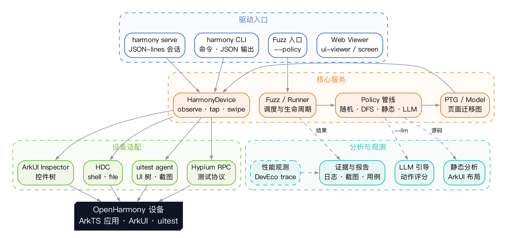

# HapTest

**面向 OpenHarmony 应用的多模态智能测试系统**

> OpenHarmony 应用的智能测试与性能观测基础设施

> 2026 开源鸿蒙大学生创新大赛 · 赛道一  
> 北京航空航天大学 SMAT 团队 · 刘发荣  
> 提交材料见 [`submission/`](submission/README.md)

HapTest 是面向 OpenHarmony 应用的多模态智能测试系统，也是 OpenHarmony 应用的智能测试与性能观测基础设施。**多模态观察是它的入口**：把控件树、截图、运行日志与任务语义放进同一次观察，向下打通 HDC、uitest agent、Hypium RPC 与 ArkUI Inspector，向上提供页面迁移图（PTG）、可扩展测试策略、`haptest harmony` 命令行与 JSON-lines 会话，并探索基于 DevEco trace 的逐帧掉帧观测。目标不是再写一个点击脚本，而是把“人的测试意图”变成“可执行、可复现、可追溯的证据”。



## 核心能力

- **设备与执行层**：`HarmonyDevice` 统一封装 HDC / uitest / Hypium；动作前必须观察、动作后 observation 立即失效；坐标动作绑定 `observationId`；选择器歧义不猜；同一设备跨进程文件租约；锁屏与认证字段有明确保护。
- **模型与探索层**：`Page` / `Component` / `ViewTree` 页面模型；`PTG` 页面迁移图；随机、朴素、贪心 DFS/BFS、静态引导、LLM 引导、回放、性能策略；`RunnerManager` 统一调度。
- **CLI 与会话层**：`haptest harmony doctor/devices/observe/apps/tap/type/key/swipe/launch/stop/serve`；stdout 永远是 JSON；退出码 0/1/2/3；失败带 `errorCode` 与 `nextStep`；`serve` 提供有状态 JSON-lines 会话。
- **分析与观测层**：静态 ArkUI 布局分析、LLM 动作评分、`PerfReport` 解析、UI viewer / screen viewer；性能观测（DevEco trace → SQLite `frame_slice` → `FrameSample`）：以逐帧切片与 jankFlag 定义掉帧，缺数据时明确报 `UNSUPPORTED_METRIC`。
- **工程规范**：TypeScript（CommonJS）；`src/` 编译到 `lib/`；vitest 单元测试；真机 E2E；GitHub Actions Linux/Windows 构建；Apache-2.0。

## 快速开始

```sh
# 依赖（NODE_ENV=production 会剪掉 devDependencies，需显式包含 dev）
NODE_ENV=development npm install --include=dev

npm run build
npm test -- --run

# 真机 E2E（无设备时 SKIPPED，退出 0）
HAPTEST_E2E_SERIAL=<serial> npm run e2e

# CLI
node bin/haptest harmony doctor
node bin/haptest harmony devices
node bin/haptest harmony observe --screenshot before.png
node bin/haptest harmony tap --text "搜索" --index 0
node bin/haptest harmony type "HapTest"
node bin/haptest harmony key BACK
node bin/haptest harmony swipe --from 500,1800 --to 500,600
node bin/haptest harmony launch com.huawei.hmos.settings
node bin/haptest harmony serve
```

### API

```ts
import { HarmonyDevice } from 'haptest';

const device = await HarmonyDevice.connect({ serial });   // 省略 serial 时要求恰好一台在线设备
const obs = await device.observe({ screenshot: true });

device.find({ text: '搜索' });
await device.tap({ selector: { text: '搜索' } });
await device.tap({ x: 500, y: 1200, observationId: obs.observationId });
await device.swipe({ from: { x: 500, y: 1800 }, to: { x: 500, y: 600 }, observationId: obs.observationId });
await device.typeText('HapTest');
await device.pressKey('BACK');
device.findApps('settings');
await device.launchApp('com.huawei.hmos.settings');
await device.stopApp('com.huawei.hmos.settings');
await device.close();
```

### Fuzz / Web

```sh
# 贪心 DFS 探索（HAP 文件、bundle 名或源码根）
node bin/haptest -i <bundle/HAP/sourceRoot> --policy greedy_dfs -o out

# UI 层级查看器
node bin/haptest ui-viewer

# 设备屏幕流
node bin/haptest screen
```

## 仓库结构

```text
bin/haptest                 CLI 入口
src/cli/                    cli.ts / harmony_command.ts / harmony_serve.ts
src/device/                 HDC、uitest agent、Hypium RPC、HarmonyDevice、租约、性能解析
src/model/                  Page / Component / ViewTree / PTG / Hap
src/policy/                 随机 / 贪心 / 静态 / LLM / 回放 / 性能策略
src/runner/                 Fuzz / RunnerManager / EventAction
src/ui/                     UI viewer / screen viewer
test/unit/                  20 个测试文件、60 个测试
test/e2e/                   真机 E2E（无 serial 时 SKIPPED）
res/uitest/                 多版本 uitest agent
static/test-demo/           ArkUI 静态分析
submission/                 2026 大赛提交材料（文档 / PPT / 视频 / 辅助材料）
```

## 状态与边界

- 2026-11-07 实测：`npm run build` 通过；`npm test -- --run` 为 20 个测试文件、60 个测试全部通过；`npm run e2e` 在无设备时 `SKIPPED` 并退出 0。
- 真机相关能力已实现并有单元测试/E2E 脚本，但本次记录时未连接设备；不声称已完成真机实测。
- 性能观测：已完成 DevEco trace 链路逆向、SQLite schema 确认与接口设计；报告只使用有数据来源的数字。
- 已知限制：`Component.text` 会清空 `TextInput/TextArea/SearchField` 文本，因此没有输入回读；锁屏判定为启发式；旧 `Hdc` 方法仍使用 `shell: true`（Node `DEP0190` 警告）；本机 TypeScript 7.0.2 与 ts-node 10.9.2 不兼容，E2E 直接运行构建产物。

## 研究来源与许可

- **FSE 2025 Industry Track**：Farong Liu, Mingyi Zhou, Yakun Zhang, Ting Su, Bo Sun, Jacques Klein, Xiang Gao, Li Li. *HapTest: The Dynamic Analysis Framework for OpenHarmony*. DOI: 10.1145/3696630.
- **ASE 2025 Industry Track**：Farong Liu, Mingyi Zhou, Li Li. *An Empirical Study on UI Overlap in OpenHarmony Applications*.
- **发明专利**：基于模块化架构的 OpenHarmony 应用动态分析框架及方法，申请号 202510375959.1，申请人北京航空航天大学。
- 仓库起源于 SMAT-Lab/HapTest 与华为开源 HapTest 工作，保留 Apache License 2.0 与上游版权头；2026 年新增 `HarmonyDevice`、CLI/会话、安全不变量、真机 E2E 与性能观测设计。详见 [`submission/05-辅助材料/来源与版权说明.md`](submission/05-辅助材料/来源与版权说明.md)。

## 提交材料

- [参赛作品简介](submission/01-参赛作品简介.pdf)
- [项目设计文档](submission/02-项目文档.pdf)
- [答辩 PPT](submission/03-答辩PPT.pdf)
- [演示视频](submission/04-演示视频.mp4)
- [材料索引与复现说明](submission/README.md)
