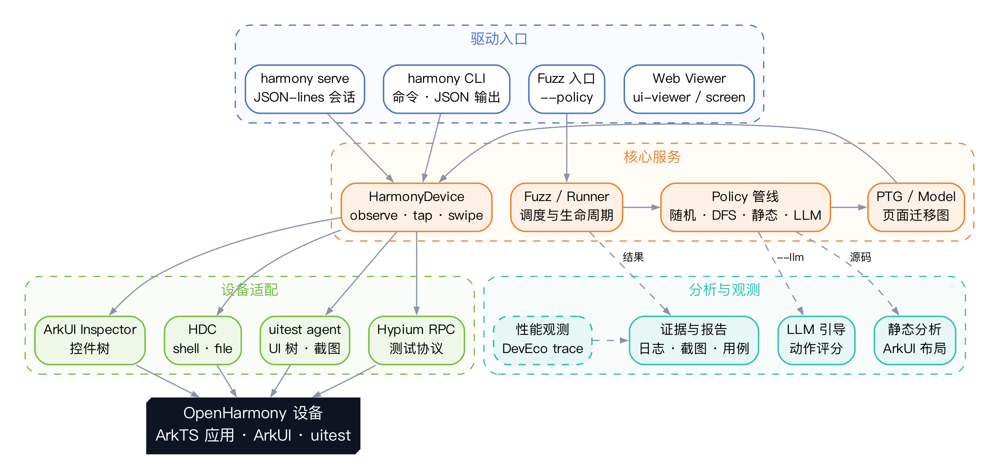
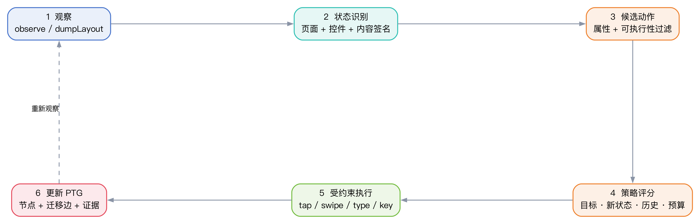
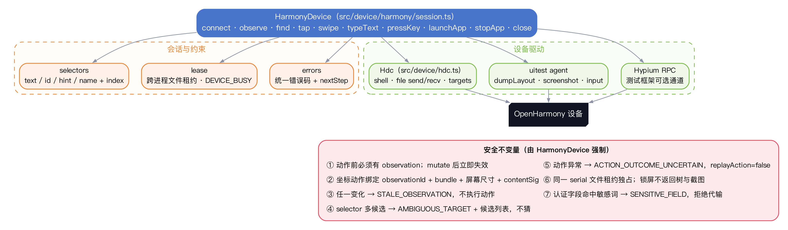
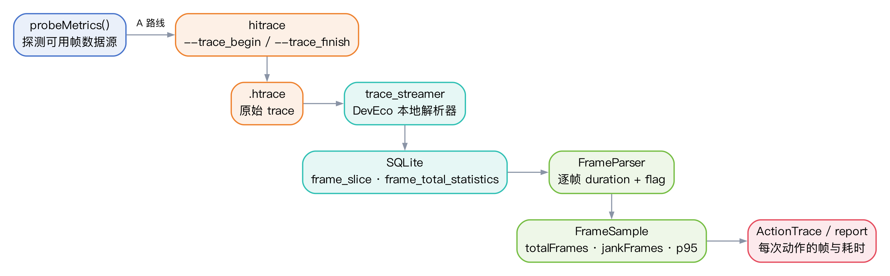
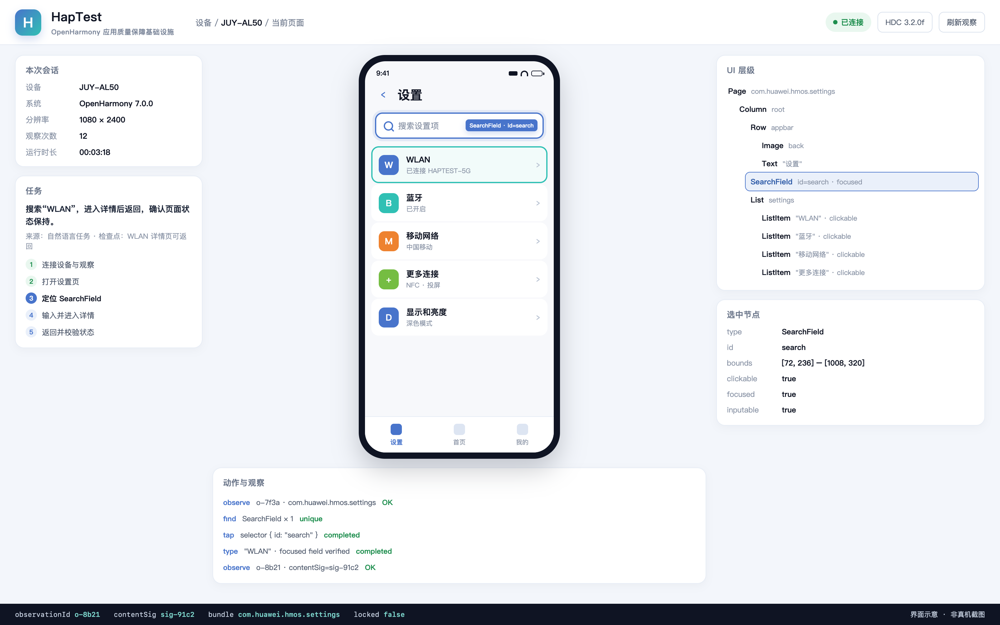

# 1 简介

## 1.1 背景

OpenHarmony 正在成为国产智能终端的重要底座。公开研究数据显示，其生态已积累超过 15,000 个应用、覆盖 9 亿台设备（FSE 2025 Industry Track 论文数据）。应用形态越丰富，页面状态、弹窗、异步加载、多设备适配与性能退化带来的质量问题就越难靠人工测试覆盖。一次加载失败后的继续操作可能触发无响应，一次页面往返可能暴露状态丢失，一次弹层遮挡可能让高开销组件在不可见时持续渲染。这些问题往往跨多个页面、多个操作连续执行才会出现，单点截图或单条脚本很难稳定复现。

OpenHarmony 应用的技术栈与 Android 有明显差异。应用使用 ArkTS 与 ArkUI 的声明式 UI，采用 Stage 模型与 Ability 生命周期；设备侧通过 HDC 提供传输与 shell 能力，通过 uitest agent 提供 UI 树、截图与输入注入，通过 Hypium 提供测试框架协议，通过 ArkUI Inspector 提供控件树。Android 上成熟的 UIAutomator、Appium 等工具无法直接迁移：控件模型、事件注入方式、应用包格式与生命周期都不同。

从测试方式看，现有人工、脚本与自动探索各有边界。人工测试能利用业务经验判断页面含义，但重复操作耗时、路径难以完整保留；脚本化测试稳定，但定位器、等待条件与初始化逻辑需要持续维护，页面一改就可能失效；随机或规则驱动的探索能自动产生操作，但对业务目标、预期结果与证据链的表达能力有限。三类方式之间缺少一层“把测试意图变成可执行动作，再把执行过程沉淀为可复用证据”的基础设施。

OpenHarmony 的工具链已经提供了可用的底层原语，但缺少统一的上层编排：HDC 负责传输，uitest 负责驱动，Hypium 负责测试组织，DevEco 负责 IDE 与性能分析。它们各自解决一段问题，却没有共同回答“当前页面是什么状态、上一步动作是否真正生效、这次失败能否复现、证据在哪里”。HapTest 要补的正是这一层。

HapTest 最初作为 OpenHarmony 应用的模块化动态分析框架提出，相关成果发表于 FSE 2025 Industry Track，并在 20 款热门商业应用中发现 26 个此前未报告的运行问题。本作品在既有框架之上，以多模态观察（控件树、截图、日志、任务语义）与智能测试策略为主线，重点完成 HarmonyOS 设备 API、CLI 与有状态会话、安全不变量、真机 E2E，以及面向 DevEco trace 的性能观测设计，使这套框架从“能跑实验”进一步变成“能被复用的质量保障基础设施”。

## 1.2 目的

本文档描述 HapTest 的系统设计，说明功能如何分解到模块、模块之间如何协作、关键接口与业务流程如何落地，为后续编码、测试、维护与评审提供依据。具体目的包括：

（1）说明作品的问题边界：面向 OpenHarmony 应用的质量保障，重点解决页面观察、状态建模、受约束执行、证据沉淀与性能观测，而不是重复实现一个 IDE 或一个测试框架。

（2）说明系统分解：设备与执行层、模型与探索层、分析与观测层、CLI 与会话层如何划分，为什么这样划分，各模块的职责与依赖关系是什么。

（3）说明关键设计取舍：为什么以 observation 为中心，为什么策略与执行解耦，为什么把 MCP/插件原型改为内部 API + CLI，为什么性能观测坚持逐帧切片而不是 fps 采样。

（4）说明接口与流程：HDC、uitest agent、Hypium RPC、ArkUI Inspector、trace_streamer 的调用方式；HarmonyDevice API、`haptest harmony` CLI、JSON-lines `serve` 的提供方式；一次 Fuzz 探索、一次 CLI 会话、一次性能观测的完整流程。

（5）说明工程现状与边界：哪些能力已经实现并有测试覆盖，哪些属于研究延伸或在研设计，哪些是明确的非目标，避免评审与后续开发产生误解。

**设计目标**：

| 编号 | 目标 | 验收方式 |
| --- | --- | --- |
| G1 | 观察可追溯：每次动作都绑定一次 observation，动作后 observation 立即失效 | 单元测试覆盖 STALE_OBSERVATION、observationId 绑定 |
| G2 | 执行可约束：歧义选择器不猜、锁屏不返回树与截图、认证字段不代输、同一设备跨进程独占 | 单元测试覆盖 AMBIGUOUS_TARGET、DEVICE_BUSY、SENSITIVE_FIELD |
| G3 | 探索可复用：PTG 记录页面与迁移，策略管线可替换，执行器共用 | 代码结构 + 真机 E2E + PTG SVG 输出 |
| G4 | 接口可驱动：CLI 输出 JSON、退出码稳定、错误带 nextStep；serve 支持有状态多步调用 | CLI 单元测试 + 手工会话 |
| G5 | 证据可复核：日志、截图、PTG、报告与失败现场关联 | 运行产物目录与报告 |
| G6 | 性能可观测：逐帧帧切片与 jankFlag，缺数据时明确报错 | 设计评审 + 解析器单测 |

**非目标**：

（1）不做 OpenHarmony 应用开发框架，不替代 ArkUI 或 DevEco。

（2）不做通用 Android 兼容层；设备适配以 OpenHarmony/HarmonyOS 的 HDC 与 uitest 能力为准。

（3）本版本不做多设备并行、跨机型兼容矩阵与自动重连；同一 serial 采用独占租约。

（4）不把“生成了脚本”当作完成度；脚本模板生成与独立回放属于后续工作，本版本先保证轨迹、证据与回放策略可用。

**读者对象**：赛事评审、OpenHarmony 工具链开发者、测试平台维护者，以及后续接手本仓库的同学。建议先读第 1 章与 2.1、2.3，再按需阅读模块与接口章节。

# 2 设计描述

## 2.1 总体设计

HapTest 把一次多模态智能测试拆成五个相互衔接的部分：多模态页面采集、页面理解与任务解析、状态图驱动的路径规划、受约束执行与结果反馈、测试用例生成与独立回放。五部分共享同一份观察记录、同一张页面迁移图与同一套执行器，避免“每个策略各自实现一遍设备操作”。

其中，多模态观察是整条链路的入口：控件树回答“有什么控件”，截图回答“看起来像什么”，日志与任务语义补上“为什么变化、要完成什么”；四者共同构成可复核的 observation。

| 模块 | 输入 | 输出 | 当前状态 |
| --- | --- | --- | --- |
| 多模态页面采集 | 设备当前前台页面、截图、日志、任务语义 | 多模态观察记录 O(t)：截图、控件树、日志、任务语义、页面标识、时间戳、observationId | 已实现控件树、截图、锁屏判定与日志收集；任务语义进入策略提示 |
| 页面理解与任务解析 | 观察记录、用户目标、历史动作 | 结构化状态 S(t)、候选交互、业务检查点 | 已实现结构化页面/控件模型与 PTG；VLM 语义理解为 ASE'25 研究延伸，未并入当前仓库主链路 |
| 状态图驱动的路径规划 | 已观察状态图、候选动作、预算 | 下一步动作 a(t) | 已实现随机、朴素、贪心 DFS/BFS、静态引导、LLM 引导、回放、性能策略 |
| 受约束执行与结果反馈 | 动作、observationId、设备状态 | 新观察 O(t+1)、执行结果、异常证据 | 已实现 HarmonyDevice 与安全不变量、一次性 CLI、JSON-lines 会话 |
| 测试用例生成与独立回放 | 执行轨迹、检查点、失败证据 | 可回放脚本、PTG、缺陷报告 | 已实现回放策略、日志/截图/PTG 证据；脚本模板生成属于后续工作 |



总体设计遵循五条原则：

（1）**观察优先**。任何动作之前必须有一次 observation；动作之后 observation 立即失效。调用方不能拿着旧页面坐标去点新页面，避免“看起来点了、实际点错”的假执行。

（2）**证据优先**。每个结论都要能回到原始观察：哪个页面、哪个控件、哪次动作、哪张截图、哪条日志。报告不把“模型说完成了”当作完成，也不把“点击成功”当作业务成功。

（3）**策略与执行解耦**。策略只负责“下一步做什么”，执行器负责“怎么安全地做、做完观察到什么”。新策略不需要重新实现设备连接、等待、异常处理与证据采集。

（4）**失败关闭**。选择器歧义、观察过期、设备被占用、锁屏、认证字段等高风险场景一律拒绝执行，并给出可执行的 nextStep，而不是猜一个候选或静默重试。

（5）**研究延伸与工程实现分层标注**。FSE'25 的框架能力、ASE'25 的多模态遮挡诊断、DevEco 性能逆向分别属于不同阶段与不同证据来源；文档与 PPT 都明确标注来源与完成度，不把设计写成已实现，也不把实验室集体成果写成个人独立完成。

## 2.2 实现思路

### 2.2.1 从“设备脚本”到“状态闭环”

传统 UI 自动化往往是“打开页面 → 点固定坐标 → 断言固定文本”。HapTest 把一次多模态智能测试表示为状态闭环：观察当前页面，识别页面与控件状态，生成候选动作，按策略评分并选择一个动作，受约束地执行，再观察新页面，把“从哪个页面、通过什么动作、到达哪个页面”写入 PTG。循环直到达到目标、预算耗尽或无法继续。

这个闭环的关键不是“多了一个图”，而是让每一步都有前后观察作为证据。PTG 的边不是模型预测出来的，而是执行后实际观察到的迁移；如果页面视觉相近但业务字段不同，系统保留差异；如果只是时间、推荐内容等无关文本变化，系统降低其对状态判定的影响。这样既能减少重复探索，也能保留触发缺陷所需的关键条件。

### 2.2.2 复用 OpenHarmony 的系统原语

HapTest 不绕过系统工具另造一套设备协议，而是复用 OpenHarmony 已有的原语：

| 原语 | 作用 | HapTest 中的使用方式 |
| --- | --- | --- |
| HDC | 设备枚举、shell、文件传输、端口转发、安装 | `Hdc` 封装 `list targets`、`shell`、`file send/recv`、`fport`、`install` 等 |
| uitest agent | UI 树 dump、截图、输入注入 | `UitestAgent` 推送并启动 `res/uitest/uitest_agent_*.so`，通过 Hypium RPC 调用 |
| Hypium RPC | 测试框架协议 | `HypiumRpc` 通过 `hdc fport` 建立本地端口，发送 JSON-RPC 请求 |
| ArkUI Inspector | 控件树与属性 | `dumpLayout` 结果解析为 `ViewTree`/`Page`/`Component` |
| DevEco trace_streamer | trace 解析为 SQLite | 性能观测设计中的 A 路线，解析 `frame_slice` 等表 |

这样做的好处是：系统升级时只需适配工具链变化，不需要维护一套私有驱动；同时可以把 HDC 的版本差异、uitest agent 的版本差异收敛在设备适配层。

### 2.2.3 策略管线：统一候选、过滤、评分与选择

策略层使用统一接口 `Policy.generateEvent(page)`。一次选择分为四步：从页面控件生成候选事件；过滤不可见、不可用、敏感或重复的候选；按“目标相关性、是否到达新状态、历史失败/重复、执行代价”评分；选择一个动作交给共用执行器。当前实现的策略包括：

| 策略 | 适用场景 | 选择逻辑 |
| --- | --- | --- |
| `manual` | 人工演示/调试 | 由调用方给出事件 |
| `naive` | 基线对照 | 按控件顺序朴素选择 |
| `random` | 探索性测试 | 在可执行候选中随机选择 |
| `greedy_dfs` | 深度优先探索 | 优先未探索、可到达新页面的动作，深入后回溯 |
| `greedy_bfs` | 广度优先探索 | 优先覆盖当前层可到达的页面 |
| `static_guided` | 源码/布局可用 | 调用 ArkUI 静态分析得到候选组件，再结合 PTG 选择 |
| `llm_guided` | 需要语义引导 | 用 LLM 对候选动作评分；当前为文本级提示，不读取截图 |
| `replay` | 回归/复现 | 按已记录轨迹回放 |
| `perf_start_hap` | 性能/内存采样 | 启动应用、采集内存/性能数据后停止 |

`--llm` 与 `--policy static_guided` 可以组合为混合策略：静态分析给出候选，LLM 在候选内评分，PTG 约束重复与预算。LLM 不是“代替执行器”，它只影响选择，不直接操作设备；执行结果仍以真实观察为准。

### 2.2.4 设备层重写：从 MCP 插件到内部 API + CLI

2026 年 11 月之前，仓库里曾有三套并行的 HarmonyOS 复刻分支与一层 MCP/插件适配。审计发现：代码骨架可用，但交付链路与验证手段坏了——21 个 MCP 工具能被发现，却没有一条能自动重跑的真机链路；插件在本机从未安装成功；三个分支、45 个提交最终只产出一份约 1600 行的源码。继续在旧结构上叠功能，只会把“看起来能演示”当成“真的能用”。

因此本轮做了三个决定：

（1）把 HarmonyOS 控制能力做成 HapTest 内部一等公民：`HarmonyDevice` 是唯一门面，任何调用方（CLI、实验脚本、未来的 Agent）都通过它使用设备。

（2）删除 MCP server、插件打包、widget 与屏幕预览等非核心适配层，减少依赖与维护面；保留 HDC、uitest agent、Hypium RPC 三条真正需要的链路。

（3）用 CLI + JSON-lines `serve` 作为交付形态：一次性命令适合 shell/Python/CI，`serve` 适合多步、有状态的 Agent 会话。两者共用同一套 API 语义，避免“CLI 一套、API 一套”。

这次重写没有改变 HapTest 既有 CLI（fuzz、ui-viewer、screen）的行为，只新增 `harmony` 子命令与公共导出；旧能力仍可按原方式使用。

### 2.2.5 安全不变量：让“不猜”成为系统行为

设备 API 的核心不是方法数量，而是失败时是否可控。`HarmonyDevice` 强制以下不变量，且由代码而不是调用方自觉保证：

（1）动作前必须有 observation；没有 observation 的动作直接拒绝。

（2）坐标动作必须携带 `observationId`，并与当前前台 bundle、屏幕尺寸、内容签名 `contentSig` 绑定；任一变化返回 `STALE_OBSERVATION`，不执行动作。

（3）selector 匹配到多个候选时返回 `AMBIGUOUS_TARGET` 与候选列表，不自动挑第一个；只有“唯一包含关系”等可证明的情形才允许自动收敛。

（4）动作抛错统一为 `ACTION_OUTCOME_UNCERTAIN`，并标记 `replayAction: false`；调用方必须先重新观察，再决定是否重试，避免重复提交、重复保存等副作用。

（5）同一 serial 由跨进程文件租约独占；第二个进程得到 `DEVICE_BUSY`，不会出现两个测试同时操作一台设备。

（6）锁屏时 `observe` 不返回 UI 树与截图；需要解锁的场景直接给出可执行提示。

（7）认证字段按 `id`/`name`/`hint` 的敏感词识别，命中后拒绝代输，要求用户在设备上直接输入。

这些不变量在 `test/unit/harmony_session.test.ts`、`device_lease.test.ts`、`harmony_cli.test.ts` 中有对应测试；它们不是“文档承诺”，而是可重跑的回归约束。

### 2.2.6 性能观测：逐帧切片，而不是 fps 采样

性能观测的设计起点是一个具体问题：“第 37 步那次滑动，掉了多少帧？为什么？”很多工具用“每秒采样一次 fps，低于阈值算一次卡顿”来近似，但这种代理指标无法回答“哪一帧、哪个动作、哪段时间”。DevEco 的做法是解析 trace：`hitrace` 产出 `.htrace`，本地 `trace_streamer` 解析成 SQLite，帧数据以 `frame_slice`/`frame_total_statistics` 表保存，包含 `frameNo`、`vsync`、`startTime`、`duration`、`jankFlag` 等字段。

因此 HapTest 把“掉帧”定义为“与 vsync 对齐的帧切片中，`jankFlag` 标记的帧”，而不是“fps 低于 55 的次数”。设计接口为 `probeMetrics()`（探测当前设备哪些帧数据源可用，返回原始输出）与 `trace(action, run)`（包住一次动作，返回 `FrameSample`：`totalFrames`、`jankFrames`、`maxFrameMs`、`p95FrameMs`）。如果设备上 `hitrace`/`trace_streamer` 不可用，返回 `UNSUPPORTED_METRIC` 并退出 3，绝不返回 `fps: 0` 或编造的帧数。

性能观测以链路逆向、SQLite schema 确认与接口设计为基础；报告只使用有数据来源的数字。

### 2.2.7 工程实现

仓库使用 TypeScript（CommonJS），`src/` 编译到 `lib/`；单元测试使用 vitest，E2E 直接 `require('../../lib')`，验证的是构建后的真实产物；GitHub Actions 覆盖 Linux 与 Windows 的 Node 18/20/21 构建。提交前要求 `npm run build` 与 `npm test -- --run` 全绿；不提交 `lib/`、`out/`。

## 2.3 系统结构

### 2.3.1 模块划分

系统按职责分为四层、五个模块。分层原则是“设备差异尽量下沉、策略差异尽量上浮、证据贯穿始终”。

| 层次 | 模块 | 关键文件 | 职责 |
| --- | --- | --- | --- |
| 驱动入口 | CLI / Web | `src/cli/cli.ts`、`src/cli/harmony_command.ts`、`src/ui/*` | 参数解析、JSON 输出、退出码、Web 可视化 |
| 核心服务 | 设备与执行 | `src/device/device.ts`、`src/device/harmony/*`、`src/device/uidriver/*` | 连接、观察、动作、租约、错误 |
| 核心服务 | 模型与探索 | `src/model/*`、`src/policy/*`、`src/runner/*` | 页面/控件模型、PTG、策略、运行循环 |
| 分析与观测 | 静态/LLM/性能/报告 | `src/policy/static_guided_policy.ts`、`src/policy/llm_guided_policy.ts`、`src/device/perf/*`、`src/ui/*` | 静态分析、LLM 评分、性能解析、证据展示 |
| 设备适配 | HDC/uitest/Hypium/ArkUI | `src/device/hdc.ts`、`src/device/uidriver/*`、`res/uitest/*` | 系统原语适配 |

模块依赖方向为：驱动入口 → 核心服务 → 设备适配 → OpenHarmony 设备；分析与观测被核心服务调用，也读取核心服务产出的观察与轨迹。反向依赖被禁止：模型层不直接调用 HDC，策略层不直接操作设备，设备层不知道策略的存在。

### 2.3.2 系统架构说明

运行时的主要参与者与交互如下：

（1）**CLI 入口**：`bin/haptest` 读取参数。`harmony` 子命令由 `harmony_command.ts` 解析，`fuzz` 由 `cli.ts` 解析。两者都先做环境检查，HDC 缺失时打印安装指引并退出 3。

（2）**连接**：`HarmonyDevice.connect` 调用 `Hdc.listTargets()`，按“无 serial 时 0/1/多台”判定；选中设备后获取文件租约、创建临时目录、建立 `Device` 会话。失败时按 `HDC_UNAVAILABLE`、`NO_DEVICE`、`MULTIPLE_DEVICES`、`DEVICE_OFFLINE`、`DEVICE_BUSY`、`CONNECT_FAILED` 分类返回。

（3）**观察**：`observe` 通过 uitest agent 的 `dumpLayout` 获取控件树，通过 HDC 获取实时屏幕尺寸，判定是否锁屏；可选截图时先复核锁屏，再 `snapshot_display` 取图，校验截图与物理屏幕的宽高比，最后生成 `observationId`、`contentSig` 与 `HarmonyObservation`。

（4）**动作**：`tap`/`swipe`/`typeText`/`pressKey` 等先 `requireObservation`，再用最新树刷新/校验；selector 走 `findHarmonyComponents`，坐标动作走 `checkCoordinates`；真正下发前再次确认前台 bundle 与内容签名，随后 `mutate()` 执行并立即失效 observation。

（5）**Fuzz 循环**：`Fuzz.start` → `RunnerManager` → `Policy.generateEvent` → `EventAction` → `Device.sendEvent` → 新 `Page` → `PTG.addTransition`。循环期间收集故障日志、截图与页面快照；达到预算或策略停止时退出。

（6）**结果**：日志写入 `out/haptest.log`，页面/PTG 写入输出目录，报告由 `PerfReport`/结果生成器整理；CLI 的 stdout 只放 JSON，人类可读摘要写 stderr。



进程与线程说明：CLI 是单进程；HDC 以子进程方式执行命令；Hypium RPC 通过 `hdc fport` 建立本地端口，Node 侧用 socket 收发；文件租约是跨进程的，租约目录位于系统临时目录，按 serial 的 SHA-256 命名。`HarmonyDevice` 内部用 `actionTail` 串行化动作，避免同一会话内并发动作导致 observation 语义漂移。

### 2.3.3 文件结构

```text
HapTest/
├── bin/haptest                     # CLI 入口
├── src/
│   ├── cli/                        # cli.ts / harmony_command.ts / harmony_serve.ts / env_checker.ts
│   ├── device/
│   │   ├── hdc.ts                  # HDC 封装
│   │   ├── device.ts               # 旧设备门面（fuzz 使用）
│   │   ├── harmony/                # HarmonyDevice / selectors / lease / errors / doctor
│   │   ├── uidriver/               # uitest agent / Hypium RPC / ArkUI driver / 截图流
│   │   └── perf/                   # PerfReport 解析
│   ├── model/                      # Page / Component / ViewTree / PTG / Hap / Snapshot
│   ├── policy/                     # 策略管线与各策略实现
│   ├── runner/                     # Fuzz / RunnerManager / EventAction
│   ├── event/                      # UI/按键/手势/系统事件
│   ├── ui/                         # UI viewer / screen viewer
│   ├── utils/                      # 日志、序列化、随机、模板、tarpit 检测
│   └── index.ts                    # 公共导出
├── test/
│   ├── unit/                       # 20 个测试文件、60 个测试
│   ├── e2e/                        # 真机链路（无 serial 时 SKIPPED）
│   └── resource/                   # 布局、perf、netstat 等 fixture
├── res/
│   ├── uitest/                     # 多版本 uitest agent .so
│   ├── ui-viewer/                  # Web 界面
│   └── screen-viewer/              # 屏幕流界面
├── static/test-demo/               # ArkUI 静态分析（arkuianalyzer）
├── doc/                            # 开发文档
├── develop/                        # HarmonyOS 适配与性能逆向记录
├── docs/superpowers/               # 设计规格与计划
└── submission/                     # 本参赛材料包
```

关键文件与规模：

| 文件/目录 | 行数/数量 | 说明 |
| --- | --- | --- |
| `src/` | 74 个 TS 文件、约 10,843 行 | 核心实现 |
| `src/device/` | 约 4,083 行 | 设备与驱动，占比最高 |
| `src/policy/` | 约 1,363 行 | 策略管线 |
| `src/model/` | 约 1,672 行 | 页面/控件/PTG 模型 |
| `src/ui/` | 约 1,141 行 | Web 可视化 |
| `test/unit/` | 20 个文件、60 个测试 | 单元与集成测试 |
| `test/e2e/run.js` | 1 条真机链路 | observe → apps → launch → tap → key → observe |
| `res/uitest/` | 6 个 agent 版本 | 适配不同设备/系统版本 |
| `static/test-demo/` | 1 个 ArkUI 分析器 | 静态引导策略使用 |

构建产物 `lib/` 与运行产物 `out/` 不进入版本库；`package.json` 的 `files` 只发布 `bin`、`lib`、`res`、`package.json`。

## 2.4 模块功能描述

本节按模板要求，从标识、类型、目的、功能列表、处理五个方面描述主要模块。为避免重复，设备与执行层按“类”描述，模型与探索层按“子包”描述。

### 2.4.1 设备与执行层

#### 2.4.1.1 Hdc（设备传输）

**标识**：`Hdc`（`src/device/hdc.ts`）。

**类型**：设备传输封装类。

**目的**：把 HDC 的命令行差异收敛为一个可测试的 TypeScript 类，向上提供设备枚举、shell、文件、端口转发、安装、截图、内存/网络信息等能力。

**功能列表**：

| 方法 | 作用 |
| --- | --- |
| `listTargets()` | 解析 `hdc list targets`，返回 serial/state |
| `getVersion()` | 获取 HDC 版本，用于诊断 |
| `excuteShellCommand()` / `excute()` | 执行 shell 命令，返回 stdout |
| `sendFile()` / `recvFile()` | 本地与设备文件传输 |
| `fport()` / `fportRm()` / `fportLs()` | 端口转发，Hypium RPC 使用 |
| `installHap()` | 安装 HAP |
| `getAllBundleNames()` / `getBundleInfo()` | 应用枚举与信息 |
| `startAblity()` / `forceStop()` | 启动/停止应用 |
| `capScreen()` | 截图到本地 |
| `inputFocusedText()` | 向当前焦点输入文本 |
| `memdump()` / `getProcMaps()` / `netstatInfo()` | 内存、进程映射、网络信息 |
| `hiperfRecord()` | 性能采样入口 |

**处理**：所有命令通过 `child_process` 执行；新增方法使用 `shell: false` 与参数数组，旧方法仍使用 `shell: true`，因此 Node 会打印 `DEP0190` 警告。该警告是已知限制，不影响功能；后续会逐步迁移到参数数组形式。

#### 2.4.1.2 UitestAgent（UI 驱动）

**标识**：`UitestAgent`（`src/device/uidriver/uitest_agent.ts`）。

**类型**：设备侧 agent 生命周期与 RPC 客户端。

**目的**：在设备上启动 uitest agent，提供 UI 树 dump、截图、输入注入等操作，是 `Device` 与 `HarmonyDevice` 的共同底座。

**功能列表**：`start()` 推送并启动 agent；`stop()` 停止；`getRpc()` 返回 `HypiumRpc`；`dumpLayout()` 获取控件树；`screenshot()` 获取截图；`input()` 注入输入。

**处理**：根据设备架构与系统版本选择 `res/uitest/uitest_agent_*.so`，通过 HDC 推送到临时目录并以 `uitest` 命令启动；RPC 通过 `hdc fport` 映射到本地端口。agent 版本不匹配时返回诊断信息，提示更换版本或检查设备。

#### 2.4.1.3 HypiumRpc（测试框架协议）

**标识**：`HypiumRpc`（`src/device/uidriver/hypium_rpc.ts`）。

**类型**：JSON-RPC 客户端。

**目的**：在 Node 与设备侧 Hypium 之间建立请求/响应通道，屏蔽 socket、端口转发与消息分片。

**功能列表**：`start()` 启动本地监听；`connect()` 建立连接；`request(method, params)` 发送请求；`removeMessageHandler()` 清理会话；`close()` 关闭；`getGeneration()` 用于断线重连后的代际判断。

**处理**：每条请求带自增 sessionId，响应按 sessionId 匹配；超时/断线返回明确错误；同一连接上的请求串行化，避免响应错配。

#### 2.4.1.4 Device（旧设备门面）

**标识**：`Device`（`src/device/device.ts`）。

**类型**：Fuzz 使用的设备门面。

**目的**：承载既有 Fuzz/策略/事件体系的设备操作，包括构建 HAP、安装、连接、dump 页面、注入事件、收集故障日志、截图、内存 dump 等。

**功能列表**：`prepareTest()`、`connect()`、`buildHap()`、`installHap()`、`dumpViewTree()`、`getCurrentPage()`、`sendEvent()`、`click()`/`swipe()`/`drag()`/`inputKey()`、`collectFaultLogger()`、`capScreen()`、`dumpHap()`、`getHapRunningState()` 等。

**处理**：`dumpViewTree` 调用 uitest agent，解析 `ViewTree` 并构造 `Page`；`getCurrentPage` 结合 `aa dump` 与前台 bundle 判定页面归属；`prepareTest` 负责安装与初始化；`collectFaultLogger` 读取设备故障日志用于崩溃/卡死证据。

#### 2.4.1.5 HarmonyDevice（新设备 API）

**标识**：`HarmonyDevice`（`src/device/harmony/session.ts`），公共导出见 `src/index.ts`。

**类型**：面向调用方的设备门面与安全约束层。

**目的**：为 CLI、实验脚本与未来的 Agent 提供稳定、可测试、失败可控的设备 API；把 observation 生命周期、坐标校验、租约、锁屏与敏感字段保护固化在门面内。

**功能列表**：

| 方法 | 说明 |
| --- | --- |
| `HarmonyDevice.connect({ serial? })` | 连接唯一在线设备；0 台/多台/离线分别报错 |
| `observe({ screenshot? })` | 返回 observationId、时间、屏幕尺寸、前台 bundle、锁屏状态、控件树、可选截图 |
| `find(selector)` | 基于最近一次 observation 查找候选 |
| `tap({ selector?, index?, x?, y?, observationId? })` | 选择器或坐标点击；坐标必须带 observationId |
| `swipe({ from, to, observationId, speed? })` | 滑动；校验坐标与观察 |
| `doubleTap` / `longPress` / `drag` | 其他坐标动作 |
| `pressKey(key)` / `pressButton(name)` | 按键/按钮 |
| `typeText(text, { allowNewlines? })` | 向唯一焦点输入；认证字段拒绝 |
| `findApps(query?)` / `launchApp(bundle)` / `stopApp(bundle)` | 应用枚举与启停 |
| `close()` | 释放设备与租约 |

**处理**：`observe` 先 dump 树、取实时尺寸、判锁屏；截图路径做前后锁屏复核与宽高比校验。`tap` 在选择器模式下先用最新树刷新候选，检测歧义与越界；坐标模式下校验 `observationId`、前台 bundle、尺寸与 contentSig。所有动作通过 `mutate()` 串行执行，执行后 `latestObservation` 失效。`close()` 等待动作队列、断开设备、释放租约。



#### 2.4.1.6 DeviceLease（跨进程租约）

**标识**：`acquireDeviceLease`（`src/device/harmony/lease.ts`）。

**类型**：文件锁工具。

**目的**：保证同一 serial 在任意时刻只有一个 HapTest 进程操作，避免两个测试争抢前台、互相打断。

**处理**：以 serial 的 SHA-256 为目录名，在系统临时目录创建 `haptest-device-<hash>.lock`；写入 `owner.json`（pid + 随机 token）。创建时用 `wx` 独占；已存在时读取 owner，若 pid 已死亡则通过“重命名到 stale 目录再删除”的方式回收；回收时校验 dev/ino，避免误删他人刚创建的新锁。释放时校验 pid 与 token，避免旧进程释放新进程的锁。

#### 2.4.1.7 selectors 与 errors

**selectors**：`HarmonySelector` 支持 `id`、`text`、`textContains`、`hint`、`name`；`findHarmonyComponents` 在 `Page` 上做精确/包含匹配，`summarizeHarmonyCandidates` 输出候选的文本、类型、边界、可点击性等，供 CLI/Agent 决策。

**errors**：`HarmonyDeviceError` 统一承载 20 个错误码（`HDC_UNAVAILABLE`、`NO_DEVICE`、`MULTIPLE_DEVICES`、`DEVICE_OFFLINE`、`DEVICE_BUSY`、`SESSION_CLOSED`、`CONNECT_FAILED`、`OBSERVE_FAILED`、`ACTION_PRECONDITION_FAILED`、`SELECTOR_NOT_FOUND`、`SELECTOR_INDEX_OUT_OF_RANGE`、`AMBIGUOUS_TARGET`、`STALE_OBSERVATION`、`INPUT_FOCUS_REQUIRED`、`SENSITIVE_FIELD`、`ACTION_OUTCOME_UNCERTAIN`、`ACTION_VERIFICATION_FAILED`、`APP_NOT_FOUND`、`APP_QUERY_FAILED`、`AGENT_DIAGNOSTIC_FAILED`）。CLI 将前置条件类错误映射为退出码 3，动作/查询失败映射为 1，用法错误映射为 2。

### 2.4.2 模型与探索层

#### 2.4.2.1 Page / Component / ViewTree

**标识**：`Page`、`Component`、`ViewTree`（`src/model/`）。

**类型**：页面与控件模型。

**目的**：把 `dumpLayout` 的 JSON 转成可查询、可比较、可序列化的对象，为策略、PTG、报告与 UI viewer 提供统一数据结构。

**功能列表**：`Page` 提供 `getComponents()`、`getBundleName()`、`getAbilityName()`、`getPagePath()`、`getContent()`、`getContentSig()`、`getStructualSig()`、`getPossibleUIEvents()`、`isForeground()`/`isBackground()`/`isStop()`；`Component` 保存 `id`、`text`、`type`、`hint`、`name`、`bounds`、`enabled`、`visible`、`clickable`、`scrollable`、`focused`、`inputable`、`checked`、`selected` 等属性，以及父子关系与层级；`ViewTree` 负责解析与归一化。

**处理**：解析时过滤不可见节点、合并重复节点、计算控件中心点与边界；对 `TextInput`/`TextArea`/`SearchField` 的文本做特殊处理（见 3.2 的已知限制）；`contentSig` 由页面内容哈希得到，用于判断“页面是否变化”。

#### 2.4.2.2 PTG（页面迁移图）

**标识**：`PTG`（`src/model/ptg.ts`）。

**类型**：有向图模型。

**目的**：记录“从哪个页面、通过什么操作、到达哪个页面”，支持可达性查询、路径回溯、未探索边/页判断与 SVG 导出。

**功能列表**：`addTransition(event, oldPage, newPage)`、`removeTransition()`、`isEventExplored()`、`isPageExplored()`、`isPageReached()`、`getReachablePages()`、`getNavigationSteps()`、`dumpSvg()`、`getExploredAbilities()`。

**处理**：页面节点以页面标识/内容签名区分；迁移边保存事件、前后页面与执行状态；`getNavigationSteps` 用最短路径算法给出从当前页到目标页的操作序列，供策略回溯；`dumpSvg` 输出可视化图，便于报告与调试。

#### 2.4.2.3 Policy 管线

**标识**：`Policy` 抽象类与 `PolicyBuilder`（`src/policy/`）。

**类型**：策略接口与工厂。

**目的**：把“下一步做什么”从设备执行中解耦，使不同探索方法可以共享执行器、PTG 与证据。

**功能列表**：`generateEvent(page)` 是唯一抽象方法；`stop()` 停止；`PolicyBuilder.buildPolicyByName()` 按 `PolicyName` 构造具体策略；`RunnerManager` 负责循环、等待、重启与 LLM/tarpit 组合。

**处理**：策略只读取 `Page` 与 `PTG`，返回 `Event`；具体事件由 `EventAction` 转成设备动作；执行后的新页面再交给策略。这样新增策略不需要改设备层。


#### 2.4.2.4 RunnerManager（运行调度）

**标识**：`RunnerManager`（`src/runner/runner_manager.ts`）。

**类型**：运行循环与策略协调器。

**目的**：驱动一次 Fuzz 运行：取当前页、生成事件、执行、等待、更新页面，必要时重启应用或切换 LLM 策略。

**处理**：普通模式下循环 `getCurrentPage` → `policy.generateEvent` → `addEvent`；遇到 `WaitEvent` 等待异步完成；LLM 模式下先用 `UITarpitDetector` 判断是否陷入重复页面，陷入且未超过最大尝试次数时用 LLM 选择事件，超过后回退；`MAX_NUM_RESTARTS` 控制崩溃/卡死后的重启次数。

### 2.4.3 分析与观测层

#### 2.4.3.1 StaticGuidedPolicy（静态引导）

**标识**：`StaticGuidedPolicy`（`src/policy/static_guided_policy.ts`）。

**类型**：基于 ArkUI 静态分析的策略扩展。

**目的**：在源码/布局可用时，从静态分析结果中获取页面组件与可交互元素，减少纯运行时的盲目尝试。

**处理**：调用 `static/test-demo/arkuianalyzer.js`（依赖 `static/test-demo/node_modules`）分析 ArkUI 布局，输出 `layout_*.json`；策略读取布局文件，建立“页面—组件”映射，再结合 PTG 选择事件。`--staticConfig` 指定静态分析配置。该模块依赖外部 Node 包，使用前需在 `static/test-demo` 下 `npm install`。

#### 2.4.3.2 LLMGuidedPolicy（LLM 引导）

**标识**：`LLMGuidedPolicy`（`src/policy/llm_guided_policy.ts`）。

**类型**：基于大模型评分的策略扩展。

**目的**：用 LLM 对候选动作做语义评分，帮助策略在“看起来都可行”的候选中选择更可能覆盖新功能/新页面的动作。

**处理**：从 `config.json` 读取 OpenAI 兼容的 `baseURL`/`apiKey`；`PromptBuilder` 把当前页面的控件、事件类型、动作 id 组织成文本提示；LLM 返回动作 id，策略异步预取下一个事件，避免阻塞执行；与 `UITarpitDetector` 配合，在重复页面时切换 LLM 或回退。当前实现是文本级提示，不读取截图；多模态 VLM 属于 ASE'25 研究组件，未并入当前仓库主链路。

#### 2.4.3.3 PerfReport（性能报告解析）

**标识**：`PerfReport`（`src/device/perf/perf_report.ts`）。

**类型**：性能数据解析器。

**目的**：解析 `perf`/`hiperf` 采样结果，把指令数、周期数、调用栈按模块/符号/线程聚合，输出可读报告。

**处理**：读取 JSON 中的 `PerfStatData`/`PerfDetailData`，构建函数调用树，计算自身/子树计数；`test/resource/perf.json` 是样例 fixture，`test/unit/perf_report.test.ts` 验证解析结果。该模块与设备侧采样解耦，可离线分析。

#### 2.4.3.4 性能观测

**标识**：`probeMetrics()` / `trace(action, run)`（设计接口，尚未实现）。

**目的**：回答“第 N 步动作掉了多少帧、哪些帧被标记为 jank”，并保证每个数字都有数据来源。

**处理**：`probeMetrics` 依次探测 `hitrace`、`trace_streamer`、`hiprofiler`、`sp_daemon` 等来源，返回原始输出与可用性；A 路线使用 `hitrace --trace_begin/--trace_finish` 产出 `.htrace`，拉回本地后调用 `trace_streamer` 解析为 SQLite；`FrameParser` 读取 `frame_slice`/`frame_total_statistics`，输出 `FrameSample`；`trace(action, run)` 用同进程包住动作窗口，保证 trace 起止与动作对齐。任一环节不可用则返回 `UNSUPPORTED_METRIC`，不返回编造数字。



#### 2.4.3.5 UI Viewer / Screen Viewer

**标识**：`startUIViewerServer`（`src/ui/ui_viewer_server.ts`）、`startScreenViewerServer`（`src/ui/screen_viewer_server.ts`）。

**目的**：把设备画面与控件树放到浏览器，便于人工检查、调试 selector 与演示。

**功能列表**：UI viewer 提供 `/api/version`、`/api/health`、`/api/harmony/devices`、`/api/harmony/connect`、`/api/harmony/screenshot`、`/api/harmony/hierarchy`、`/api/harmony/hierarchy/xpathLite` 与 `/ui-viewer` 页面；screen viewer 提供 `/api/reconnect`、`/api/status`、`/stream.mjpg` 与 `/screen-viewer` 页面。

**处理**：UI viewer 按需连接设备，拉取截图与层级树，前端展示树结构并支持复制 XPath-lite；screen viewer 通过 MJPEG 流持续推送屏幕，断线可重连。两者都是只读展示，不承载动作执行，避免误操作。

#### 2.4.3.6 报告与证据

一次运行保留：`haptest.log`（步骤、错误、耗时）、页面截图、PTG SVG、故障日志、失败现场（当前页面/控件/动作）、性能报告（可用时）。报告把“执行成功”“页面变化”“业务正确”分开记录：控件存在且动作成功只证明执行层完成；页面跳转证明发生了迁移；业务是否正确仍要由检查点或人工规则判断。

### 2.4.4 CLI 与会话层

#### 2.4.4.1 `haptest harmony` 一次性命令

| 命令 | 作用 | 关键 flag |
| --- | --- | --- |
| `doctor` | 检查 HDC、设备、uitest agent | `--serial` |
| `devices` | 列出 HDC 可见设备 | 无 |
| `observe` | 读取当前树与可选截图 | `--serial`、`--screenshot <file>` |
| `apps` | 列出已安装 bundle | `--query` |
| `tap` | 选择器或坐标点击 | `--id/--text/--text-contains/--hint/--name/--index` 或 `--x/--y` |
| `type` | 向焦点输入文本 | `--allow-newlines` |
| `key` | 按键 | `BACK/HOME/ENTER/DELETE/SPACE/TAB/ESCAPE/UP/DOWN/LEFT/RIGHT` |
| `swipe` | 滑动 | `--from x,y --to x,y --speed` |
| `launch` / `stop` | 启动/停止应用 | bundle 位置参数 |
| `serve` | 有状态 JSON-lines 会话 | `--serial` |

一次性命令的内部流程是“先 observe、再动作、再 observe”：`tap`/`type`/`key`/`swipe`/`launch`/`stop` 都先取一次 observation，支持 `--expect-bundle`/`--expect-sig` 做跨进程的等价校验，动作后输出新的 observation 摘要。stdout 永远是 JSON；人类可读摘要与安装指引写 stderr。

#### 2.4.4.2 JSON-lines `serve`

`serve` 每行一个请求、每行一个响应，方法名与 API 同名：`observe`、`find`、`tap`、`swipe`、`type_text`、`press_key`、`apps`、`launch_app`、`stop_app`、`close`。请求/响应示例：

```json
{"id":1,"method":"observe","params":{}}
{"id":1,"ok":true,"result":{"observationId":"o1","bundleName":"com.example.app","contentSig":"sig-1","tree":{}}}
{"id":2,"method":"tap","params":{"selector":{"text":"OK"}}}
{"id":2,"ok":true,"result":{"outcome":"completed"}}
{"id":3,"method":"close","params":{}}
{"id":3,"ok":true,"result":{"closed":true}}
```

非法 JSON 返回 `BAD_REQUEST`，未知方法返回 `UNKNOWN_METHOD`，关闭后再请求返回 `SESSION_CLOSED`；这三种情况都不会结束进程。请求按到达顺序串行处理，避免同一设备上的动作交错。

#### 2.4.4.3 既有 `haptest` CLI

`haptest` 保留原有 fuzz 入口：`-i/--hap`（bundle 名、HAP 文件或源码根）、`--policy`、`-o/--output`、`-t/--target`、`-c/--coverage`、`--llm`、`--simK`、`--staticConfig`、`--exclude`；子命令 `ui-viewer` 与 `screen` 分别启动 Web 查看器与屏幕流。`EnvChecker` 在启动前检查 HDC、设备与应用信息，缺失时打印安装指引并退出 3，而不是抛裸错误。

## 2.5 业务/实现流程说明

### 2.5.1 一次 Fuzz 探索流程

（1）**环境准备**：`haptest -i <bundle/HAP/源码根> --policy greedy_dfs -o out`。`EnvChecker` 检查 HDC 是否在 PATH、设备是否在线、目标应用是否存在；`haptest harmony doctor` 可单独做同样的检查。

（2）**构建与安装**：若输入是源码根，`Device.buildHap` 调用命令行工具构建 HAP；`prepareTest` 安装并启动应用；若输入是已安装 bundle，则跳过构建。

（3）**连接与初始化**：`Device.connect` 建立 HDC 会话，启动 uitest agent，获取屏幕尺寸与前台页面；`getCurrentPage` 构造首个 `Page`。

（4）**策略循环**：`RunnerManager` 调用 `Policy.generateEvent(page)` 生成事件；`EventAction` 把事件转为点击/滑动/输入/按键/系统事件；`Device.sendEvent` 下发并等待页面稳定；`getCurrentPage` 重新观察；`PTG.addTransition` 记录迁移；重复直到策略停止、预算耗尽或达到最大重启次数。

（5）**异常处理**：应用崩溃/卡死时 `collectFaultLogger` 收集故障日志与截图；`RunnerManager` 按 `MAX_NUM_RESTARTS` 重启应用并继续；若无法恢复，保存当前结果并退出。

（6）**结果输出**：`out/` 下保留日志、截图、PTG SVG、故障证据；`--coverage` 时额外输出覆盖率；`--llm` 时记录 LLM 调用与回退；`perf_start_hap` 策略输出启动/内存采样结果。

涉及进程/线程：主进程是 Node CLI；HDC 命令以子进程执行；uitest agent 运行在设备侧；Hypium RPC 通过本地端口与设备侧通信；文件租约跨进程。整个循环在单进程内串行，避免多线程同时操作设备。

### 2.5.2 一次 harmony CLI 会话流程

以下命令序列来自当前构建产物（无设备时 `devices` 返回空数组，`doctor` 返回 `DEVICE_NOT_READY`）：

```text
$ node bin/haptest harmony
{"ok":false,"errorCode":"USAGE","message":"a command is required"}

$ node bin/haptest harmony devices
{"ok":true,"devices":[]}

$ node bin/haptest harmony doctor
{"ok":false,"errorCode":"DEVICE_NOT_READY","hdcVersion":"Ver: 3.2.0f","devices":[],"issues":["No connected HarmonyOS device is available."]}
```

有设备时的典型流程：

（1）`haptest harmony doctor` 确认 HDC、设备、agent 就绪；失败时按 `HDC_UNAVAILABLE`/`NO_DEVICE`/`DEVICE_OFFLINE` 给出 nextStep。

（2）`haptest harmony observe --screenshot before.png` 获取 observationId、前台 bundle、屏幕尺寸、控件树与截图。

（3）`haptest harmony tap --text "搜索" --index 0`：CLI 先 observe，再按 selector 查找；若多个候选且没有 `--index`，返回 `AMBIGUOUS_TARGET` 与候选列表；若坐标模式，必须提供 `--x/--y`，CLI 用本次 observation 的 observationId 绑定。

（4）`haptest harmony type "HapTest"`：要求设备上恰好一个焦点可编辑控件；没有焦点返回 `INPUT_FOCUS_REQUIRED`；认证字段返回 `SENSITIVE_FIELD`。

（5）`haptest harmony key BACK` / `haptest harmony swipe --from 500,1800 --to 500,600`：动作后 CLI 再次 observe，输出新的 observationId 与 contentSig；旧 observationId 立即失效。

（6）`haptest harmony serve`：多步会话用 JSON-lines；每行一个请求，`observe` 返回 observationId，后续 `tap`/`swipe` 可复用；`close` 结束并释放租约。

错误示例：如果传入旧的 `--expect-sig`，CLI 返回 `STALE_OBSERVATION`，退出 3，不执行动作；如果设备被另一个 HapTest 进程占用，返回 `DEVICE_BUSY`，提示关闭另一个进程。

### 2.5.3 性能观测流程

（1）`probeMetrics()`：在设备上依次探测 `hitrace`、`trace_streamer`、`hiprofiler_cmd`、`sp_daemon`，记录原始输出；优先选择 A 路线（`hitrace` + 本地 `trace_streamer`）。

（2）`trace(action, run)`：在同一进程内先 `hitrace --trace_begin`，执行 `run()`（一次 tap/swipe/launch），再 `hitrace --trace_finish -o /data/local/tmp/xxx.htrace`；把 trace 拉回本地。

（3）`trace_streamer`：用 DevEco 自带的本地二进制解析 `.htrace`，生成 SQLite；读取 `frame_slice`（frameNo、vsync、ts、dur、flag、type_desc）与 `frame_total_statistics`。

（4）`FrameParser`：按动作时间窗口过滤帧，计算 `totalFrames`、`jankFrames`、`maxFrameMs`、`p95FrameMs`；写入 `ActionTrace`。

（5）报告：把每一步的帧数据与动作、页面、截图关联；缺数据时在报告中显式列出 `missing: [{metric, reason}]`，不填 0、不省略行。

失败处理：如果探测不到任何可用来源，`trace()` 抛 `UNSUPPORTED_METRIC`，CLI 退出 3；如果 trace 解析失败，保留原始 `.htrace` 与 `trace_streamer` 输出，报告中标注“未解析”，便于复现。

## 2.6 接口描述

### 2.6.1 调用接口

**HDC**：

| 接口 | 用途 | 备注 |
| --- | --- | --- |
| `hdc list targets` | 设备枚举 | 解析 serial/state；`Connected` 才可用 |
| `hdc -t <serial> shell <cmd>` | 设备 shell | 读取属性、启动/停止应用、dump 布局等 |
| `hdc file send/recv` | 文件传输 | 推送 agent、拉取截图/trace |
| `hdc fport` | 端口转发 | Hypium RPC 本地端口 |
| `hdc install` | 安装 HAP | 测试准备 |
| `hdc shell aa dump` | Ability/任务信息 | 前台页面判定 |
| `hdc shell snapshot_display` | 截图 | `capScreen` |
| `hdc shell uitest` | UI 驱动 | dumpLayout/screenshot/input |
| `hdc shell hidumper` | 系统信息 | 诊断 |
| `hdc shell hiperf` | 性能采样 | `PerfReport` 数据来源之一 |

**uitest agent**：

| 接口 | 参数 | 返回 |
| --- | --- | --- |
| `dumpLayout` | 是否 dismiss 键盘 | 控件树 JSON |
| `screenshot` | 输出路径 | 图片文件 |
| `input` | 坐标/文本/按键 | 执行结果 |
| `start/stop` | agent 路径 | 进程状态 |

**Hypium RPC**：

| 接口 | 说明 |
| --- | --- |
| `start()` | 启动本地 socket 与端口转发 |
| `connect(timeoutMs)` | 连接设备侧 agent |
| `request(method, params)` | 发送 JSON-RPC 请求，按 sessionId 匹配响应 |
| `close()` | 关闭连接与端口 |

**ArkUI Inspector / DevEco trace_streamer**：

| 接口 | 说明 |
| --- | --- |
| `dumpLayout` | ArkUI 控件树；`ViewTree` 解析 |
| `trace_streamer` | 本地解析 `.htrace` 为 SQLite；需 `DYLD_LIBRARY_PATH` 指向 `dic_server/lib` |
| `frame_slice` / `frame_total_statistics` | 帧切片与统计表；字段见 2.2.6 |

**版本要求**：HDC 3.2.0f（本机实测）；OpenHarmony 5.0.0（FSE'25 实验设备）与 OpenHarmony 7.0.0.105/API 26（本机真机记录）；Node 18/20/24；TypeScript 5；uitest agent 按设备架构/版本选择 `res/uitest/` 中的 `.so`。

### 2.6.2 提供接口

**HarmonyDevice TypeScript API**：

```ts
const device = await HarmonyDevice.connect({ serial });   // 省略 serial 时要求恰好一台在线设备
const obs = await device.observe({ screenshot: true });

device.find({ text: '搜索' });
await device.tap({ selector: { text: '搜索' } });
await device.tap({ x: 500, y: 1200, observationId: obs.observationId });
await device.swipe({ from: { x: 500, y: 1800 }, to: { x: 500, y: 600 }, observationId: obs.observationId });
await device.typeText('HapTest');
await device.pressKey('BACK');
device.findApps('settings');
await device.launchApp('com.huawei.hmos.settings');
await device.stopApp('com.huawei.hmos.settings');
await device.close();
```

**CLI**：命令与 flag 见 2.4.4.1；成功时 stdout 为 `{"ok":true,...}`，失败时为 `{"ok":false,"errorCode":...,"message":...,"nextStep":...}`。退出码：0 成功；1 动作/查询失败；2 用法错误；3 前置条件不满足（HDC 缺失、无设备、锁屏、过期 observation、设备被占用、认证字段等）。

**serve 协议**：见 2.4.4.2；请求字段 `id`/`method`/`params`，响应字段 `id`/`ok`/`result` 或 `id`/`ok`/`error`。方法：`observe`、`find`、`tap`、`swipe`、`type_text`、`press_key`、`apps`、`launch_app`、`stop_app`、`close`。

**输出 schema（observe 摘要）**：

```json
{
  "ok": true,
  "observation": {
    "observationId": "o-...",
    "observedAt": "2026-11-07T12:00:00.000Z",
    "serial": "....",
    "width": 1080,
    "height": 2400,
    "bundleName": "com.example.app",
    "contentSig": "sig-...",
    "locked": false,
    "tree": { "...": "..." }
  }
}
```

## 2.7 UI 设计

本作品的“UI”分两类：开发者/测试人员看的 Web 查看器，以及脚本/Agent 读的终端 JSON。

**UI viewer**：页面分为三栏。左栏是设备列表与连接按钮，显示 serial、state、HDC 版本；中栏是当前截图，按设备物理分辨率缩放，保留坐标映射；右栏是控件树，按层级展开，节点显示类型、id、text、bounds、clickable 等属性，选中节点可在截图上高亮，并可复制 XPath-lite。顶部是“刷新/连接/抓取当前页”与状态提示；底部显示 observationId 与 contentSig，便于与 CLI 输出对齐。查看器只读，不提供点击/输入，避免误操作设备。

**Screen viewer**：以 MJPEG 流持续显示设备屏幕，支持重连与状态查询；适合演示与手工观察，不承担动作。

**终端**：`haptest harmony` 的 stdout 只输出 JSON，便于管道处理；stderr 输出人类可读摘要、安装指引与 nextStep。颜色只用于 stderr，避免污染 JSON。



设计取舍：没有把所有信息塞进一个页面，而是把“看”和“做”分开。查看器负责理解页面与定位控件，CLI/API 负责执行；这样即使查看器断开，测试脚本仍可独立运行。

# 3 其他

## 3.1 成员分工

本作品由刘发荣承担全部工作。具体分工与证据如下：

| 工作流 | 内容 | 证据 |
| --- | --- | --- |
| 需求与架构 | 问题定义、模块划分、接口与安全不变量设计 | 本文档、`docs/superpowers/specs/` |
| 设备与执行层 | HDC/uitest/Hypium 适配、HarmonyDevice、租约、selectors、errors | `src/device/harmony/`、`src/device/uidriver/` |
| CLI 与会话 | `haptest harmony`、`serve`、退出码与错误面 | `src/cli/harmony_command.ts`、`harmony_serve.ts` |
| 模型与策略 | Page/Component/PTG、策略管线、RunnerManager | `src/model/`、`src/policy/`、`src/runner/` |
| 测试与 E2E | 60 个单元测试、真机 E2E 链路、构建/CI | `test/unit/`、`test/e2e/`、`.github/workflows/` |
| 文档与演示 | 设计文档、PPT、演示视频、辅助材料 | `submission/` |
| 研究积累 | FSE'25 论文（第一作者）、ASE'25 论文（第一作者）、发明专利（北京航空航天大学） | 论文与专利原件，见 05-辅助材料 |

说明：FSE'25 与 ASE'25 论文由刘发荣作为第一作者与 SMAT 团队、合作单位共同完成；专利申请人/专利权人为北京航空航天大学。本仓库代码起源于 SMAT-Lab/HapTest 与华为开源 HapTest 工作，保留 Apache-2.0 LICENSE 与上游版权头；本作品新增部分为 HarmonyOS 设备 API、CLI/会话、安全不变量、真机 E2E 与性能观测设计。

## 3.2 困难与思考

**（1）没有真机，如何避免“假验证”。**

开发期 `hdc` 不在 PATH，设备也不一定在手边。团队没有用 mock 数据冒充真机结果，而是把“无设备”做成可解释的状态：`doctor` 返回 `DEVICE_NOT_READY` 与安装指引；E2E 无 serial 时打印 `SKIPPED` 并退出 0；CLI 的 `devices` 返回空数组；文档要求性能数字必须可追溯。这样评审能看到真实边界，后续接上设备也能直接跑。

**（2）HDC 的版本与命令差异。**

不同 DevEco/SDK 版本的 HDC 命令输出格式、`shell` 参数转义、`fport` 行为都有差异。旧代码用 `shell: true` 拼接命令，Node 会打印 `DEP0190` 警告；新方法改用 `shell: false` + 参数数组。`Hdc.getVersion()` 与 `doctor` 把版本暴露出来，便于定位“命令不对”还是“设备不对”。

**（3）输入框内容读不到。**

`Component.text` 的转换会清空 `TextInput`/`TextArea`/`SearchField` 的文本，`observe` 返回的树里这些字段的 `text` 恒为空，因此没有输入回读。团队没有用“猜光标在末尾”的方式做 verify（那是假验证），而是要求“恰好一个焦点可编辑控件”、拒绝认证字段、动作后重新观察页面；输入是否正确由业务检查点或人工确认。这是一个明确的已知限制，后续可通过 uitest 的文本查询接口补齐。

**（4）锁屏判定是启发式。**

当前只认 `ScreenLockRootComponent` / `MainPageView_Screen_Lock_Home` 等特征；识别不到时按未锁屏处理。换机型需要复核。团队选择“宁可少判锁屏，也不返回不可靠的树与截图”：`observe` 在截图前后各做一次锁屏复核，发现锁屏就删除树与截图，避免把锁屏画面当成应用页面。

**（5）选择器歧义与“包含关系”。**

同一文本可能命中多个控件（列表项、按钮、隐藏副本）。系统默认拒绝歧义，返回候选列表与索引；只有“唯一包含关系”等可证明的情形才自动收敛。这个选择会让自动化多一步 `--index`，但避免了“点错还报告成功”的更坏结果。

**（6）MCP/插件弯路的教训。**

早期为了接入 Agent 宿主，做了 MCP server、插件市场、widget 三层适配，45 个提交、3 个分支，最终只有一份约 1600 行的源码；插件在本机从未安装成功，21 个工具能被发现却没有一条能自动重跑的真机链路。后来把适配层删掉，改为内部 API + CLI + 真机 E2E，代码量和维护面都下降，交付反而更稳。教训是：先有可重跑的端到端链路，再谈宿主集成；不要把“能被发现”当成“能用”。

**（7）TypeScript/ts-node 的版本坑。**

本机 TypeScript 7.0.2 是 ts-node 的 peer 自动安装，与 ts-node 10.9.2 不兼容，`npm run haptest`/`npm run dump` 会失败。E2E 因此直接 `require('../../lib')`，验证构建产物，不走 ts-node；`npm run build`、`npm test`、`npm run e2e` 不受影响。这个坑写进了 `AGENTS.md`，避免后来者重复踩。

**（8）性能逆向的边界。**

DevEco 的性能管线依赖 `trace_streamer`、protobuf 消息与 SQLite schema；本地二进制能跑，但设备侧 `flag` 枚举值、`hitrace` 可用性、商业机 `hiprofiler` 是否存在都未验证。团队先把 schema、接口与失败行为设计清楚，明确“没有数据就报 `UNSUPPORTED_METRIC`”，而不是用截图差异或 fps 采样冒充逐帧数据。这是对评审最诚实的做法，也是后续真机日最容易继续的工作。

**（9）范围控制。**

独立完成完整系统，最大的风险不是写不出来，而是范围失控。本轮明确砍掉：MCP/插件、widget、多设备并行、跨机型矩阵、脚本模板生成、实时性能仪表盘；保留：设备 API、CLI/会话、安全不变量、PTG/策略、测试与文档。砍掉的功能在文档中标注为后续工作，不写成已完成。

## 3.3 参考

[1] OpenHarmony 官方文档：ArkTS、ArkUI、Ability、Stage 模型。https://docs.openharmony.cn/

[2] OpenHarmony UiTest 官方指南与 arkXTest 仓库。

[3] Hypium 测试框架文档。

[4] DevEco Studio Profiler 与 trace_streamer 文档/本地安装。

[5] Farong Liu, Mingyi Zhou, Yakun Zhang, Ting Su, Bo Sun, Jacques Klein, Xiang Gao, Li Li. HapTest: The Dynamic Analysis Framework for OpenHarmony. FSE Companion '25, 2025. DOI: 10.1145/3696630.

[6] Farong Liu, Mingyi Zhou, Li Li. An Empirical Study on UI Overlap in OpenHarmony Applications. ASE 2025 Industry Track.

[7] 北京航空航天大学. 基于模块化架构的 OpenHarmony 应用动态分析框架及方法. 发明专利申请号 202510375959.1, 2025.

[8] SMAT-Lab/HapTest 开源仓库与华为开源 HapTest 工作。

[9] TypeScript、Node.js、vitest、Express、commander、graphology、log4js、adm-zip、image-hash、openai SDK 官方文档。

[10] SQLite 文档与 DevEco `frame_slice`/`frame_total_statistics` schema（见 `develop/deveco-perf-sources.md`）。

# 附录 A 构建与测试记录

以下记录来自 2026-11-07 在当前工作区的实际执行：

```text
$ npm run build
> haptest@0.2.3 build
> tsc
（退出码 0，无错误）

$ npm test -- --run
Test Files  20 passed (20)
Tests       60 passed (60)
Duration    3.89s

$ npm run e2e
SKIPPED: set HAPTEST_E2E_SERIAL to the target device serial.
Find it with: hdc list targets
（退出码 0）
```

仓库统计：

| 指标 | 数值 |
| --- | --- |
| `src/` TypeScript 文件 | 74 |
| `src/` 代码行数 | 约 10,843 |
| `test/unit/` 测试文件 | 20 |
| 单元测试数 | 60 |
| `feat/harmonyos-device-api` 相对 `main` | 37 个文件，+6,794 / -23 |
| 带 Huawei 版权头的源文件 | 57 |

# 附录 B 术语表

| 术语 | 含义 |
| --- | --- |
| HDC | HarmonyOS Device Connector，设备连接与调试工具 |
| uitest | OpenHarmony UI 测试驱动，提供 dumpLayout、截图、输入注入 |
| Hypium | OpenHarmony 测试框架，提供 RPC 协议 |
| ArkUI Inspector | ArkUI 控件树检查工具 |
| PTG | Page Transition Graph，页面迁移图 |
| observation | 一次页面观察，含 observationId、树、截图、时间、前台 bundle |
| contentSig | 页面内容签名，用于判断页面是否变化 |
| jank | 掉帧；本作品定义为 vsync 对齐的帧切片中被 jankFlag 标记的帧 |
| trace_streamer | DevEco 本地 trace 解析器，将 `.htrace` 转为 SQLite |
| FSE | ACM International Conference on the Foundations of Software Engineering |
| ASE | IEEE/ACM International Conference on Automated Software Engineering |
